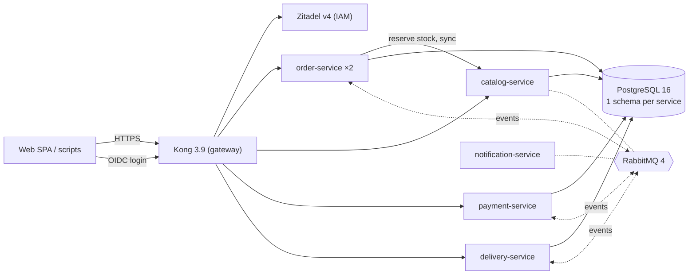

# Urban Online Clothing Store — Order & Delivery Coordination
> Microservices course, Project 04: distributed workflows, cancellations and state consistency.

Local boutiques sell garments online; staff prepare orders, local couriers deliver within 2 hours.
The platform coordinates order, stock, payment and delivery across independently deployable services.

## Group members
| # | Role |
|:--|:--|
| 1 | Lead architect & order-service (state machine, saga, compensations) |
| 2 | catalog-service (stock, reservations) |
| 3 | delivery-service (courier assignment, tracking) |
| 4 | payment-service (simulator, refunds) |
| 5 | Security & DevOps (Kong, Zitadel, observability, CI, load tests) |

## Architecture (target)


| Concern | Choice |
|---|---|
| Gateway / LB | Kong OSS 3.9.x, DB-less |
| Identity | Zitadel v4 (OIDC), JWT validated in each service |
| Services | Node.js 24 · TypeScript · Fastify |
| Data | PostgreSQL 16, one schema + role per service |
| Messaging | RabbitMQ 4.x (topic exchange, DLQ, idempotent consumers) |
| Observability | Prometheus + Grafana + cAdvisor |
| Deployment | Docker Compose on the university server |

## Repository
```text
services/<name>-service/   one folder per service (src, package.json, README)
infra/kong/                gateway configuration
docs/                      software architecture document
contracts/                 OpenAPI specification
Dockerfile                 shared image for all Node.js services
docker-compose.yml         full stack
```
Each folder has its own README describing its responsibility and current status.

## Status
**Iteration 1 — skeleton**: Kong routes to 5 services with health checks, automatic restart and round-robin.
Database, broker, authentication and business logic come in the next iterations.
The SAD and OpenAPI in `docs/` and `contracts/` still describe the previous draft and are realigned in iteration 2.

## Run (on the server)
Prerequisites: Docker Engine 24+ with Compose v2.
```bash
cp .env.example .env
docker compose up -d --build
docker compose ps                                  # all services "healthy"

curl -i localhost:8000/api/v1/orders               # 200 {"items":[]} + X-Request-ID + X-Instance
curl -i localhost:8000/api/v1/catalog/items
curl -i localhost:8000/api/v1/payments
curl -i localhost:8000/api/v1/deliveries
curl -i localhost:8000/api/v1/unknown              # 404 from Kong
```
Load balancing and automatic restart:
```bash
docker compose up -d --scale order-service=2
for i in $(seq 6); do curl -si localhost:8000/api/v1/orders | grep -i x-instance; done   # alternates
docker compose exec order-service kill 1          # process stops → restarted by Docker
docker compose ps order-service
curl -s localhost:8001/upstreams/order-upstream/health   # Kong's view of replicas (server only)
```
Stop: `docker compose down` (keeps data) · reset: `docker compose down -v` (destroys volumes).
