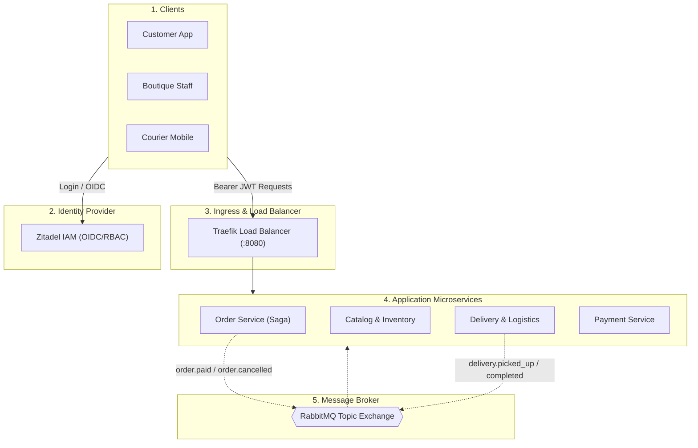

# Urban Online Clothing Store Platform
> **Microservices Architecture Project 04: Order and Delivery Coordination**  
> *Distributed workflows, cancellations, and state consistency*

[](#)
[](#)
[](#)
[](#)
[](#)

---

## 👥 Group Members & Roles

| Members | Role & Core Responsibilities |
| :--- | :--- |
| **1** | **Lead Architect & Order Service:** Saga Orchestrator, State Transitions, Compensations. |
| **2** | **Catalog & Inventory Service:** Stock management, 10-minute hold TTL, Stock release. |
| **3** | **Delivery & Logistics Service:** Courier dispatch, Optimistic locking, Telemetry. |
| **4** | **Payment & External Integration:** Payment simulator, Automated refunds. |
| **5** | **Security & DevOps:** Zitadel IAM (OIDC/RBAC), Traefik Load Balancer, Metrics & k6 tests. |

---

## Project Overview

This platform implements an on-demand, local fashion retail coordination system. Unlike postal parcel delivery, this platform enables fast local fulfillment ($\le 2$ hours) from physical city boutiques directly to customers through local couriers.

### Key Architectural Capabilities:
1. **Saga Orchestrator (Order Service):** Manages long-running transactions and executes compensating actions if payment fails or a customer cancels prior to courier pickup.
2. **Concurrency Control:** Enforces optimistic locking to prevent race conditions (e.g., competing couriers claiming the same delivery mission, or cancellation colliding with pickup).
3. **Database-per-Service:** Each microservice owns its isolated persistent storage; zero cross-service SQL joins.
4. **Zitadel IAM:** Production-ready identity provider issuing OIDC/JWT tokens with Role-Based Access Control (`CUSTOMER`, `STAFF`, `COURIER`, `ADMIN`).
5. **Traefik Ingress & Load Balancer:** Round-robin request distribution across scaled service replicas with health checks.
6. **Informative Error Handling:** Standardized RFC-compliant error payloads with actionable resolution messages for clients.

---

## Repository Structure

```text
micro-service/
│
├── README.md                      # Entry-point project documentation (this file)
│
├── docs/                          # Architecture Dossier & Schemas
│   ├── Architecture_Dossier.pdf   # Complete Software Architecture Document
│   ├── software_architecture_document.tex  # LaTeX source code
│   └── software_architecture_document.md   # Markdown version
│
└── contracts/                     # Interface Specifications
    └── openapi.yaml               # OpenAPI 3.0 specification for all microservices
```

---

## Interaction Architecture (Synchronous REST & Asynchronous Events)



---

## API Contracts (OpenAPI 3.0)

All REST contracts are documented in [`contracts/openapi.yaml`](./contracts/openapi.yaml).

To view the interactive Swagger UI locally:
1. Open [editor.swagger.io](https://editor.swagger.io/).
2. Import `contracts/openapi.yaml`.
3. Test endpoints with sample JSON payloads, authentication headers, and simulated `409 Conflict` errors.

---

## Planned Validation & Experiments

| Experiment | Target Scenario | Tool / Method |
| :--- | :--- | :--- |
| **1. Concurrent Transitions** | 50 concurrent couriers accepting the same delivery + concurrent customer cancel. | Python / k6 scripts |
| **2. Load & Replication** | 1 instance vs. 3 replicas under 1,000 requests. Verify Traefik Round-Robin. | k6 / JMeter |
| **3. Step Failure & Recovery** | Kill `payment-service` mid-saga. Verify RabbitMQ DLQ retry and automatic recovery. | Docker Chaos |
| **4. RBAC Verification** | Unauthorized role attempts (e.g. Courier creating orders, Customer claiming deliveries). | Postman / Newman |
| **5. Rolling Update** | Zero-downtime update between service v1 and v2 with instant rollback. | Docker rolling update |


## Route Plan

1. The first step is to create the docker compose so that everyone can work simultaneously
2. Create all the backend function
3. Then we should make a small interface on each services to be able to use them correctly
4. After that we will try to put in place solutions to keep the services going even during a failure scenario
5. And finally, we will try to overload the services to see if our load balancer is working properly
