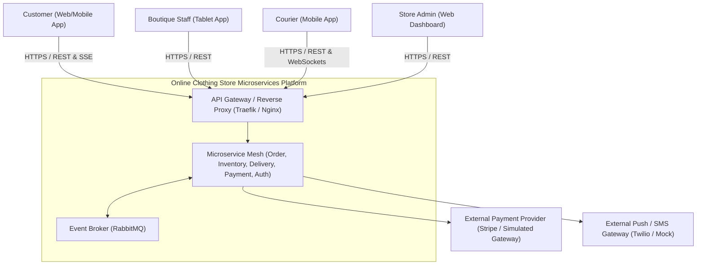
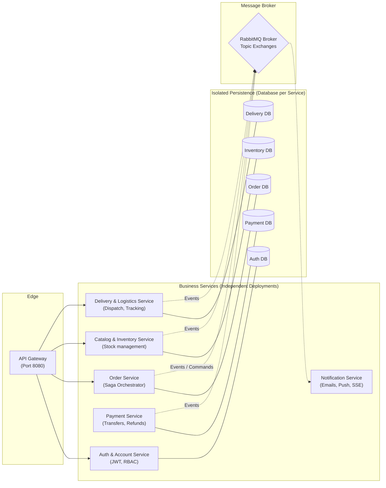
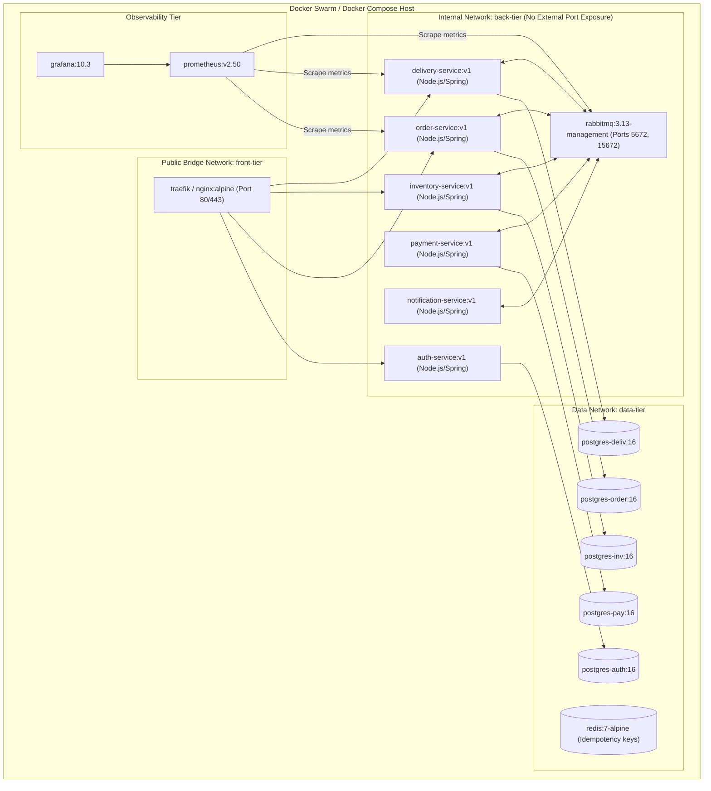
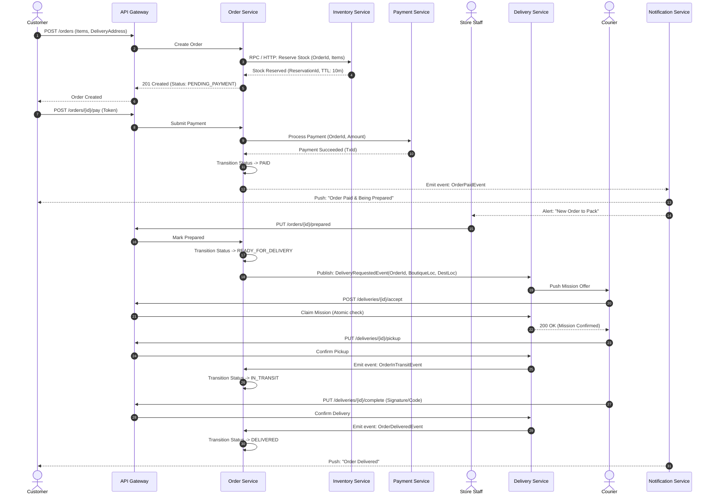
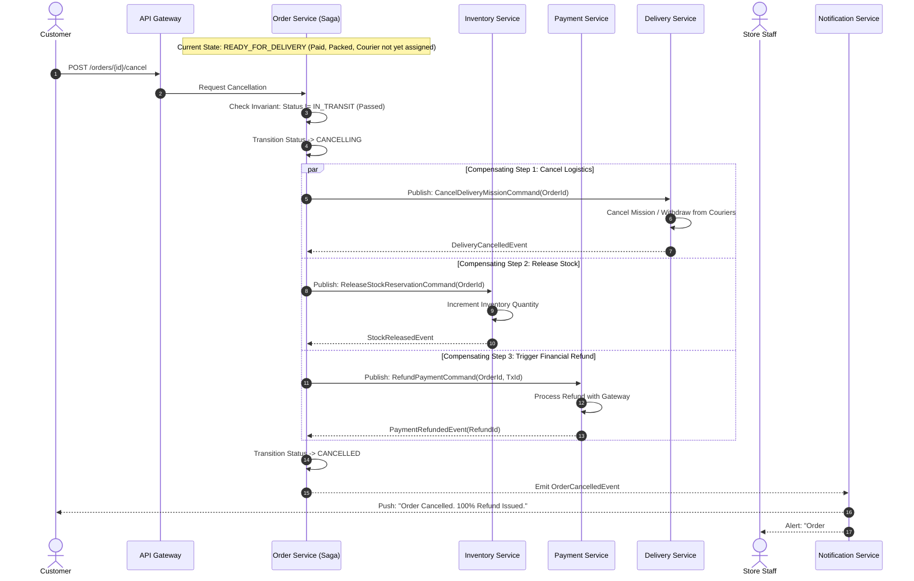

# Software Architecture Document (Intermediate Submission)
**Project Title:** Distributed Order and Delivery Coordination Platform  
**Domain Context:** Urban Online Clothing Store Platform  
**Course:** Microservices Architecture  
**Document Version:** 1.0.0 (Intermediate Submission)  
**Authors / Group Members:**  
- [Student Name 1] (Role: Order & Saga Orchestration)
- [Student Name 2] (Role: Catalog, Inventory & Payments)
- [Student Name 3] (Role: Logistics, Delivery & Routing)
- [Student Name 4] (Role: Authentication, API Gateway & Security)
- [Student Name 5] (Role: DevOps, Observability & Validation Tests)

---

## 1. Context, Scope and Requirements

### 1.1 Application Domain & Problem Statement
The platform coordinates on-demand, local fashion retail fulfillment. Unlike standard asynchronous postal delivery, this platform handles fast local delivery (same-day / within-2-hour delivery) from urban physical clothing boutiques or micro-fulfillment hubs directly to customers via local couriers.

This domain introduces strict physical and business constraints:
- Garment inventory is limited, with unique size/color stock items. Items cannot be reserved indefinitely without payment.
- Preparation requires a physical staff member to locate, pack, and flag garments ready.
- Logistics depends on mobile couriers with vehicle capacity constraints and real-time availability.

### 1.2 Actors & Roles
1. **Customer (Requester):** Browses clothing stock, reserves items, completes payment, tracks status, and can cancel before courier pickup.
2. **Staff Member (Store / Boutique):** Receives confirmed orders, packs clothing parcels, flags orders as `READY_FOR_DELIVERY`.
3. **Courier (Fulfillment Agent):** Views available delivery dispatches, accepts delivery missions, updates transit milestones (`PICKED_UP`, `DELIVERED`).
4. **Store Manager / Admin:** Manages catalog items, tracks platform health, and handles escalated compensation cases.

### 1.3 Key User Journeys
- **Journey 1: Order Creation to Delivery (Happy Path):** Customer places order $\rightarrow$ inventory is provisionally reserved $\rightarrow$ payment succeeds $\rightarrow$ staff prepares parcel $\rightarrow$ courier accepts dispatch $\rightarrow$ courier picks up & delivers $\rightarrow$ customer receives notification.
- **Journey 2: Customer Pre-Fulfillment Cancellation (Graceful Compensation):** Customer cancels order while status is `PENDING_PREPARATION` or `READY_FOR_DELIVERY` $\rightarrow$ system cancels delivery request, releases garment stock, triggers payment refund.
- **Journey 3: Courier Rejection & Logistics Timeout:** No courier accepts delivery mission within 15 minutes $\rightarrow$ system alerts staff, retries with higher radius or prompts customer for rescheduled delivery slot.
- **Journey 4: Concurrent Race Condition (Cancellation vs. Pickup):** Customer initiates cancellation at the exact second a courier clicks `PICKED_UP`. System enforces invariants: once parcel is physically collected by courier, customer direct cancellation is rejected; returns workflow must be initiated instead.

### 1.4 Business Rules & Invariants
- **INV-1 (Stock Atomicity):** Garment stock is decremented tentatively during checkout with a 10-minute TTL. If payment is not completed within 10 minutes, reservation expires and stock returns to the catalog.
- **INV-2 (Single Assignment):** Exactly one courier can be assigned to an active delivery mission. Distributed locks or optimistic version locks (`version` counter) prevent double-assignment.
- **INV-3 (Point of No Return):** Customer cancellation is permissible ONLY prior to state `IN_TRANSIT` (after courier pickup).
- **INV-4 (Compensating Transactions):** Any terminal failure during the saga (e.g., payment declined, stock out-of-sync) must trigger compensating events to undo prior partial side-effects.

### 1.5 Workload Profiles & Measurable Targets

| Metric / Dimension | Target (Production Projection) | Testable Threshold (Demo / Local Docker) |
| :--- | :--- | :--- |
| **Normal Load Throughput** | 150 orders / minute | 30 orders / minute |
| **Peak Load Throughput** | 1,200 orders / minute | 100 orders / minute |
| **Order Creation p95 Latency** | $\le 250\text{ ms}$ | $\le 400\text{ ms}$ |
| **End-to-End State Propagation Delay** | $\le 1.5\text{ s}$ across microservices | $\le 2.0\text{ s}$ via message broker |
| **Concurrent Conflict Handling** | 100% rejection of double courier claim | 100% rejection (verified by k6/JMeter) |
| **Service Recovery Time (MTTR)** | $< 15\text{ s}$ container restart | $< 10\text{ s}$ via Docker healthcheck restart |
| **Compensating Consistency** | 100% reconciled balance & stock | 100% verified after simulated failure |

### 1.6 Alignment with Mandatory Contextual Constraints
1. **Long-Running Workflow:** The lifecycle of an order spans minutes to hours (customer $\rightarrow$ payment $\rightarrow$ staff packing $\rightarrow$ courier transport). Coordination uses Saga Orchestration with durable event tracking.
2. **Temporary Component Unavailability:** Message queues with Dead Letter Exchanges (DLX) and exponential backoff retry mechanisms guarantee message delivery even when downstream consumers crash.
3. **Different Load & Freshness Requirements:** Status tracking queries (read-heavy, eventual consistency tolerated $\le 2\text{ s}$) are decoupled from transition state commands (write-heavy, strict consistency enforced via transactional outbox).
4. **Irreversible Real-World Actions:** Once clothes are physically picked up or delivered, digital rollback is impossible. The system transitions to an escalation/refund state rather than an uncoordinated database rollback.

---

## 2. Architecture Views

### 2.1 System Context View (C4 Level 1)



### 2.2 Service Decomposition & Domain Responsibilities (C4 Level 2)

The architecture is decomposed into five distinct core business services plus infrastructural components:



#### Service Boundaries & Persistence Rules
- **No Shared Database:** Every microservice owns its schema and private database volume. Direct SQL joins across services are strictly prohibited.
- **Order Service (Orchestrator):** Authoritative owner of `Order` aggregate lifecycle (`CREATED`, `PAID`, `PREPARING`, `READY_FOR_PICKUP`, `IN_TRANSIT`, `DELIVERED`, `CANCELLED`).
- **Catalog & Inventory Service:** Authoritative for SKU attributes, physical garment availability, and tentative reservations with lock TTLs.
- **Payment Service:** Authoritative for transaction logs, payment intents, and refund authorizations. Interfaces with external gateway simulator.
- **Delivery & Logistics Service:** Authoritative for `DeliveryMission` state machine, courier real-time telemetry, mission assignment locks, and courier vehicle metadata.
- **Notification Service:** Lightweight event consumer. Broadcasts status updates to clients via WebSockets / Server-Sent Events (SSE).

### 2.3 Deployment View



---

### 2.4 Interaction Sequences

#### Scenario 1: Successful Order, Preparation & Delivery (Happy Path)



#### Scenario 2 (Failure 1): Customer Cancellation during Preparation (Compensating Saga)



#### Scenario 3 (Failure 2): Concurrent Race Condition - Cancellation Request vs. Courier Pickup

```mermaid
sequenceDiagram
    autonumber
    actor Customer
    actor Courier
    participant Gateway as API Gateway
    participant DelivSvc as Delivery Service
    participant OrderSvc as Order Service (State Machine)

    Note over OrderSvc,DelivSvc: Courier is physically at store; Customer clicks Cancel simultaneously
    par
        Customer->>Gateway: POST /orders/{id}/cancel
        Gateway->>OrderSvc: Command: CancelOrder(id)
    and
        Courier->>Gateway: PUT /deliveries/{id}/pickup
        Gateway->>DelivSvc: Command: ConfirmPickup(id)
    end

    DelivSvc->>OrderSvc: Emit event: OrderPickedUpEvent (Arrives at t = 0.01s)
    OrderSvc->>OrderSvc: Process OrderPickedUpEvent -> Transition to IN_TRANSIT (Committed)

    Note over OrderSvc: CancelOrder command is processed at t = 0.02s
    OrderSvc->>OrderSvc: Evaluate State Guard: CurrentState == IN_TRANSIT
    Note over OrderSvc: Guard fails! Violation of INV-3
    OrderSvc-->>Gateway: 409 Conflict {"error": "ORDER_ALREADY_IN_TRANSIT", "cancellationAllowed": false}
    Gateway-->>Customer: 409 Conflict: "Item is already on its way. Please initiate a return upon receipt."
```

---

## 3. API and Message Contracts

### 3.1 Public REST API Specification (OpenAPI Subset)

#### Order Service API
- **Endpoint:** `POST /api/v1/orders`
  - **Permission:** Role `CUSTOMER`
  - **Idempotency-Key Header:** `X-Idempotency-Key: <UUID>` (Required)
  - **Request Schema:**
    ```json
    {
      "boutiqueId": "boutique-casablanca-01",
      "items": [
        { "sku": "SHIRT-SLIM-M-BLK", "quantity": 1 },
        { "sku": "JEANS-REG-32-BLU", "quantity": 2 }
      ],
      "deliveryAddress": {
        "street": "123 Blvd d'Anfa",
        "city": "Casablanca",
        "lat": 33.589886,
        "lng": -7.633036
      }
    }
    ```
  - **Responses:**
    - `201 Created`: `{ "orderId": "ord_987654", "status": "PENDING_PAYMENT", "totalAmount": 780.00, "currency": "MAD", "expiresAt": "2026-11-03T15:10:00Z" }`
    - `400 Bad Request`: Validation failure.
    - `409 Conflict`: Insufficient stock for selected SKU.

- **Endpoint:** `POST /api/v1/orders/{orderId}/cancel`
  - **Permission:** Role `CUSTOMER` (Resource Owner) or `ADMIN`
  - **Responses:**
    - `200 OK`: `{ "orderId": "ord_987654", "status": "CANCELLING", "message": "Compensation initiated" }`
    - `409 Conflict`: Order already `IN_TRANSIT` or `DELIVERED`.

#### Delivery & Logistics API
- **Endpoint:** `POST /api/v1/deliveries/{deliveryId}/accept`
  - **Permission:** Role `COURIER`
  - **Headers:** `Authorization: Bearer <JWT>`
  - **Responses:**
    - `200 OK`: `{ "deliveryId": "del_112233", "status": "ASSIGNED", "courierId": "cour_55" }`
    - `409 Conflict`: `{ "error": "MISSION_ALREADY_CLAIMED", "assignedToOther": true }`

### 3.2 Asynchronous Message Contracts (RabbitMQ)

#### Exchange Configuration
- **Exchange Name:** `order.events.exchange` (Type: `topic`, Durable: `true`)
- **Dead Letter Exchange (DLX):** `order.dlx.exchange` (Type: `fanout`)
- **Default TTL:** 60000ms with max 3 retry attempts before routing to DLQ.

#### Message Schemas
1. **Event: `OrderPaidEvent`**
   - **Routing Key:** `order.lifecycle.paid`
   ```json
   {
     "eventId": "evt_a1b2c3d4",
     "timestamp": "2026-11-03T15:00:00Z",
     "version": "1.0",
     "aggregateId": "ord_987654",
     "payload": {
       "orderId": "ord_987654",
       "customerId": "cust_100",
       "boutiqueId": "boutique-casablanca-01",
       "amountPaid": 780.00,
       "currency": "MAD",
       "items": [
         { "sku": "SHIRT-SLIM-M-BLK", "quantity": 1 }
       ]
     }
   }
   ```

2. **Command: `ReleaseStockReservationCommand`**
   - **Routing Key:** `inventory.command.release_stock`
   ```json
   {
     "commandId": "cmd_e5f6g7h8",
     "timestamp": "2026-11-03T15:05:00Z",
     "correlationId": "ord_987654",
     "payload": {
       "orderId": "ord_987654",
       "reason": "CUSTOMER_CANCELLATION"
     }
   }
   ```

3. **Message Ordering & Idempotency Strategy**
   - **Duplicate Delivery:** RabbitMQ guarantees *at-least-once* delivery. Consumers maintain an `idempotent_consumer_events` table indexed on `(event_id, consumer_name)`. If a duplicate arrives, the consumer acknowledges immediately without re-processing.
   - **Ordering:** Messages concerning the same `orderId` use routing keys partitioned or ordered by single-consumer queues where sequential transitions are required.

---

## 4. Technical Mechanisms and Tools

| Architectural Requirement | Selected Tool / Pattern | Affected Components | Essential Configuration & Strategy | Verification Method |
| :--- | :--- | :--- | :--- | :--- |
| **Routing & Gateway** | **Traefik v3 / Nginx** | Edge Ingress | Route prefix matching (`/api/v1/orders`), SSL termination, CORS headers. | `curl -k https://localhost/api/v1/...` |
| **Service Discovery & Load Balancing** | **Docker Internal DNS + Traefik** | All microservices | Round-robin load balancing across scaled replicas (`docker compose up --scale order-service=2`). | Inspect HTTP response headers (`X-Backend-Server-ID`). |
| **Health Checks & Auto-Restart** | **Docker Compose `healthcheck`** | All containers | `interval: 10s`, `timeout: 5s`, `retries: 3`, `restart: on-failure`. Checks `/actuator/health` or `/healthz`. | `docker kill <container_id>` and verify automatic respawn within 10s. |
| **Resilience & Timeouts** | **Resilience4j / Axios Retry** | Inter-service HTTP calls | HTTP client timeout: 2.5s. Max retries: 3 with exponential backoff and jitter. | Block downstream port with `iptables` or toxiproxy. |
| **Authentication & RBAC** | **JWT with RSA-256 (or Keycloak)** | Auth Service & API Gateway | Stateless verification at Gateway; claims contain `roles: ["CUSTOMER", "COURIER", "STAFF", "ADMIN"]`. | Attempt courier claim with customer token $\rightarrow$ verify `403 Forbidden`. |
| **Distributed Tracing & Correlation** | **OpenTelemetry + W3C TraceContext** | All services & RabbitMQ | Every ingress request injects `traceparent` header; propagated across RabbitMQ headers. | Trace an end-to-end order flow in Grafana / Jaeger UI. |
| **Metrics & Monitoring** | **Prometheus + Grafana** | All services | Microservices export `/metrics` (order throughput, p95 latencies, DLQ message counts). | Grafana dashboard displays real-time spikes during load test. |

---

## 5. Architectural Decision Records (ADRs)

### ADR-01: Orchestration-Based Saga vs. Choreography-Based Saga
- **Status:** Accepted
- **Context:** The fulfillment process spans multiple services with complex cancellation scenarios, compensations, and strict sequencing.
- **Decision:** Use an **Orchestration Saga** hosted in the `Order Service`.
- **Alternatives Considered:** Pure event-driven Choreography.
- **Justification & Trade-offs:** In choreography, cancellation logic becomes scattered across Inventory, Delivery, and Payment services, leading to "cyclic event storms" and difficult debugging. The orchestrator explicitly manages state transitions (`CANCELLING`, `COMPENSATING`) in a single state machine. The trade-off is a tighter coupling of the Order Service to the workflow definition, which is acceptable given the clear business boundaries.

### ADR-02: Isolated Database per Service vs. Shared Relational Store
- **Status:** Accepted
- **Context:** Ensuring loose coupling, independent scalability, and autonomous deployments.
- **Decision:** Implement **Database-per-Service** (each service has its dedicated PostgreSQL database container and volume).
- **Alternatives Considered:** Single shared PostgreSQL instance with separate schemas.
- **Justification & Trade-offs:** A shared database creates accidental coupling at the disk/connection level and allows developers to bypass API contracts via cross-table joins. Physical isolation guarantees team boundaries. The cost is the inability to run ACID transactions across services, which is mitigated by our Saga pattern.

### ADR-03: Concurrency Control on Courier Assignment
- **Status:** Accepted
- **Context:** Multiple couriers within range may simultaneously click "Accept Mission" for the same high-paying garment delivery.
- **Decision:** Implement **Optimistic Locking with Versioning** combined with a Redis-backed distributed lock / unique constraint (`UNIQUE(order_id)`) on the assignment table.
- **Alternatives Considered:** Pessimistic database table locking (`SELECT ... FOR UPDATE`).
- **Justification & Trade-offs:** Pessimistic locks lock rows across high-concurrency requests, drastically reducing throughput. Optimistic locking immediately awards the mission to the first atomic committer; subsequent requests receive `409 Conflict` in under 15ms.

### ADR-04: Asynchronous Messaging via RabbitMQ vs. Apache Kafka
- **Status:** Accepted
- **Context:** Reliable inter-service messaging, task dispatching, and compensation triggers.
- **Decision:** Use **RabbitMQ** with AMQP 0-9-1.
- **Alternatives Considered:** Apache Kafka.
- **Justification & Trade-offs:** Our workload requires complex routing keys (`topic` exchanges), dead-letter handling, and transactional worker task queuing rather than streaming millions of immutable events/logs per second. Kafka introduces heavy operational overhead (Zookeeper/KRaft, partition management) unjustified for a 5-service local architecture.

---

## 6. Planned Validation & Experiments

To satisfy Section 5 of the project requirements, the following five automated experiments are planned:

### Experiment 1: Concurrent State Transitions (Race Condition Test)
- **Objective:** Verify that conflicting concurrent requests maintain state invariants without data corruption.
- **Method:** Using a k6 / python concurrency script, fire simultaneous requests at $t_0$:
  - Thread A: `POST /orders/123/cancel` (Customer)
  - Thread B: `POST /deliveries/123/accept` (Courier 1)
  - Thread C: `POST /deliveries/123/accept` (Courier 2)
- **Expected Outcome:**
  - Exactly one courier receives `200 OK`; the other receives `409 Conflict`.
  - If courier acceptance commits first, customer cancellation receives `409 Conflict (ORDER_ALREADY_IN_TRANSIT)`.
  - Zero double-assignments or orphaned deliveries.

### Experiment 2: Load & Replication Comparison (1 vs. N Instances)
- **Objective:** Measure latency and throughput differences between a single service instance and multiple scaled instances behind Traefik.
- **Workload:** 100 concurrent virtual users generating 1,000 order creation requests over 3 minutes.
- **Metrics Collected:** p95 latency, requests per second (RPS), CPU saturation, and queue backlog.
- **Expected Outcome:** Scaled instances ($N=3$) absorb load spikes with p95 latency staying $< 300\text{ ms}$, whereas $N=1$ degrades with p95 $> 1200\text{ ms}$ and dropped requests.

### Experiment 3: Failure of a Workflow Step & Automatic Recovery
- **Objective:** Demonstrate system resilience when downstream dependencies fail mid-workflow.
- **Method:** Inject failure by terminating the `Payment Service` container (`docker stop payment-service`) during active checkouts.
- **Expected Outcome:**
  - Order Service places messages in RabbitMQ retry queues.
  - When `Payment Service` restarts (`docker start payment-service`), pending messages are consumed and processed automatically without data loss.

### Experiment 4: Role-Based Access Control (RBAC) Verification
- **Objective:** Ensure security boundaries are enforced across all endpoints.
- **Method:** Automated test suite (Postman / PyTest) testing unauthorized operations:
  - Courier trying to cancel another customer's order.
  - Customer attempting to accept a delivery mission.
  - Unauthenticated requests to catalog stock administration.
- **Expected Outcome:** 100% of unauthorized requests return `401 Unauthorized` or `403 Forbidden`.

### Experiment 5: Rolling Update & Zero-Downtime Rollback
- **Objective:** Upgrade `delivery-service:v1` to `delivery-service:v2` under active traffic and roll back safely.
- **Expected Outcome:** Zero dropped HTTP requests during rolling restart; health checks smoothly switch traffic between old and new replicas.
